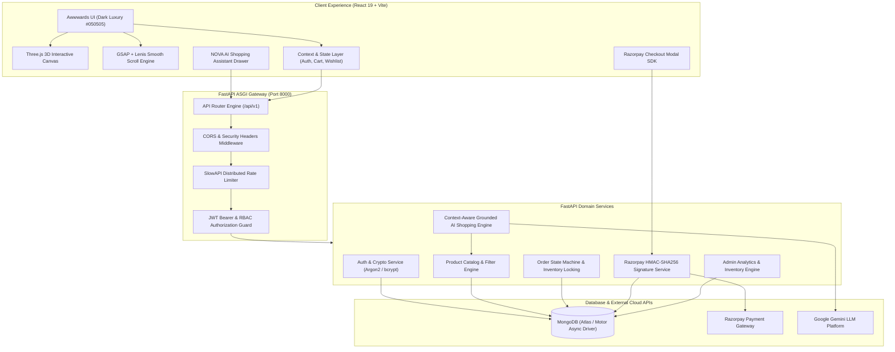
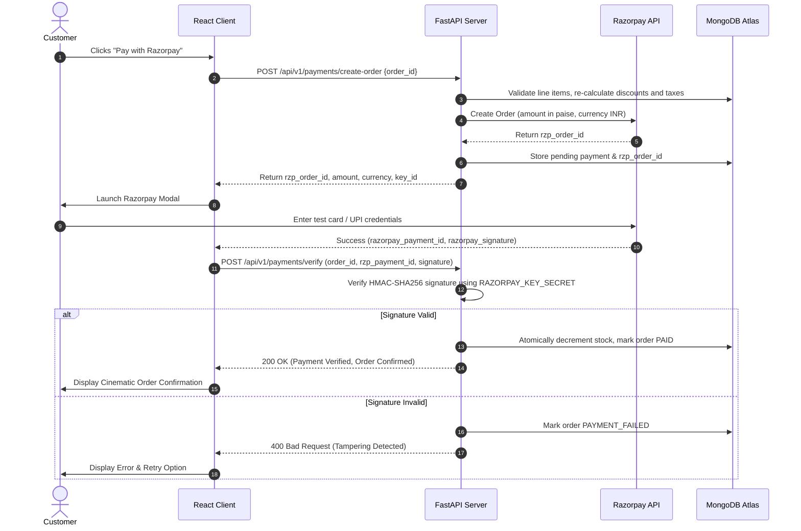

# NOVA STORE — Comprehensive System Architecture Specification

> **Brand**: NOVA STORE  
> **Tagline**: *Beyond Shopping. Experience Innovation.*  
> **Aesthetic Philosophy**: Futuristic, Minimalist, Cinematic, Technology-Driven Luxury.

---

## 1. High-Level Architectural Topology

NOVA STORE is architected as an enterprise-grade, decoupled client-server platform designed for sub-100ms API responses, 60 FPS interactive animations, and zero-trust cryptographic verification for payments and authentication.

---

## 2. Brand Identity & Visual Design System

### 2.1 Color Tokens
- **Background**: `#050505` (Deep space void)
- **Secondary Background**: `#0A0A0F` (Dark twilight slate)
- **Cards & Surfaces**: `#111116` (Refined frosted glass card)
- **Primary Accent**: `#A855F7` (Neon Purple / Cyber Violet)
- **Secondary Accent**: `#00E5FF` (Electric Cyan / Holographic Glow)
- **Main Text**: `#FFFFFF` (High contrast pure white)
- **Secondary Text**: `#A1A1AA` (Muted zinc typography)
- **Border**: `#25252D` (Subtle dark boundary)

### 2.2 Typography
- **Headings & Badges**: `Space Grotesk` (Geometric, futuristic, technical)
- **Body & Product Specs**: `Inter` (Legible, neutral, human-centric)

### 2.3 Visual Inspiration & Creative Direction
- **SeaCat by Rossinavi**: Cinematic luxury, immersive full-screen visuals, obsidian glassmorphism, subtle neon ambient halos, and elegant typography.
- **ICON × Khaby Lame**: Scroll-driven storytelling, interactive 3D product inspection stages, creative section transitions, and fluid HUD telemetry overlays.

---

## 3. Technology Stack Specification

| Tier | Technology | Purpose |
|---|---|---|
| **Frontend Framework** | React 19 + Vite | Component rendering, fast HMR, tree-shaken bundles |
| **Styling** | Tailwind CSS + PostCSS | Utility-first styling with custom glassmorphism plugins |
| **Motion & Scroll** | GSAP 3 + ScrollTrigger + Lenis | Smooth inertia scroll, parallax effects, pinned storytelling |
| **Component Physics** | Framer Motion | Fluid modals, mobile drawers, cart counters, badge alerts |
| **3D Graphics** | Three.js / Canvas | Holographic product visualization and neon particle clouds |
| **Data Visualization** | Recharts | Admin sales velocity, category revenue breakdown charts |
| **Iconography** | Lucide React | Precision minimalist iconography |
| **HTTP Networking** | Axios | Request/response interceptors with automatic token refresh |
| **Backend Framework** | Python 3.11+ / FastAPI | Asynchronous high-throughput ASGI microservices |
| **Data Contracts** | Pydantic v2 | Strict serialization, deserialization, and schema validation |
| **Async DB Driver** | Motor (AsyncIOMotorClient) | Non-blocking async MongoDB queries with pooling |
| **Database** | MongoDB Atlas / Local MongoDB | Dynamic document persistence with compound indexes |
| **Auth & Crypto** | PyJWT + Passlib (Argon2 / bcrypt) | Stateless JWT tokens, PBKDF2 / Argon2 password hashing |
| **Payment Gateway** | Razorpay SDK (Test Mode) | Server-side order creation and HMAC-SHA256 signature verification |
| **AI Assistant** | Gemini API via Backend | Grounded natural-language product search and recommendations |
| **Rate Limiting** | SlowAPI | Protection against DDoS and brute-force abuse |
| **Testing** | Pytest (Backend) + Vitest (Frontend) | Automated end-to-end unit, contract, and integration tests |

---

## 4. Frontend Architecture & Complete 22 Pages

The application structure supports the complete customer and administrative journey:

1. **Home Page (`/`)**: Award-winning cinematic hero, 3D canvas, GSAP pinned showcase, trending drops, editorial reviews, interactive newsletter.
2. **Shop Catalog (`/shop`)**: Multi-faceted filter sidebar (categories, price sliders, in-stock, sort), grid/list views, search query persistence.
3. **Product Details (`/product/:slug`)**: Multi-angle gallery with zoom, variant selector (color, storage/size), live inventory badge, dynamic pricing, reviews carousel, related products.
4. **Product Category (`/category/:slug`)**: Dedicated category landing with tailored banner, sub-tag filtering, and curated product feed.
5. **Search Results (`/search`)**: Instant keyword search results, highlighted matches, fallback suggestions when 0 matches found.
6. **Cart (`/cart`)**: Real-time line items, quantity steppers, coupon discount calculator, shipping estimator, subtotal breakdown, free shipping progress bar.
7. **Checkout (`/checkout`)**: Multi-step checkout with address selection/creation, order summary, Razorpay checkout modal trigger.
8. **Login (`/login`)**: Secure customer & admin authentication with demo credentials quick-fill for ease of evaluation.
9. **Register (`/register`)**: Account creation with real-time password strength validation.
10. **Forgot Password (`/forgot-password`)**: Email submission for password reset recovery.
11. **Reset Password (`/reset-password`)**: Secure token-based password reset form.
12. **User Dashboard (`/dashboard`)**: Central customer hub: recent order cards, default shipping address, wishlist summary, account shortcuts.
13. **User Profile (`/profile`)**: Personal details editing, password updating, notification preferences.
14. **My Orders (`/orders`)**: Complete order history with status pills (`PROCESSING`, `SHIPPED`, `DELIVERED`), invoice viewing, and reorder options.
15. **Wishlist (`/wishlist`)**: Saved luxury items, instant "Move to Cart" button, empty-state discovery recommendations.
16. **Order Tracking (`/track-order`)**: Interactive visual timeline with real-time delivery milestones and carrier metadata.
17. **About Us (`/about`)**: Brand narrative, engineering philosophy, sustainability pledge, interactive timeline.
18. **Contact Us (`/contact`)**: Support ticket inquiry form, concierge email, headquarters map overlay.
19. **Privacy Policy (`/privacy`)**: Enterprise GDPR / CCPA compliant data disclosure.
20. **Terms and Conditions (`/terms`)**: E-commerce legal framework, return policies, payment terms.
21. **Admin Dashboard (`/admin`)**: Operations suite: revenue charts, low-stock alerts, product CRUD modal, order status state machine, user list.
22. **Custom 404 Page (`/404`)**: Cinematic space void with interactive particle gravity and instant navigation back to safety.

---

## 5. Homepage Cinematic Experience (11 Sections)

- **Section 1: Navbar**: Transparent sticky blur navbar, glowing logo, navigation links, search trigger, customer account, wishlist counter badge, interactive cart drawer toggle.
- **Section 2: Hero Experience**: Full-screen viewport, animated mesh gradient background, floating cyber particles, 3D product canvas, GSAP headline reveal ("THE FUTURE OF SHOPPING"), dual CTA buttons ("EXPLORE COLLECTION" & "DISCOVER NOVA").
- **Section 3: Featured Collection**: Interactive luxury cards, hover zoom transitions, dynamic pricing, rating stars, quick "Add to Cart" action.
- **Section 4: Trending Products**: Live MongoDB feed, limited-edition badges, discount chips, heart wishlist toggle, direct product modal.
- **Section 5: Categories**: 6 curated domains (Technology, Fashion, Electronics, Accessories, Lifestyle, Home Products) with image parallax cards.
- **Section 6: Immersive Storytelling**: Full-screen scroll-pinned product teardown inspired by ICON x Khaby Lame & SeaCat, showing exploded hardware architecture, titanium casing, and bio-acoustic sensors.
- **Section 7: New Arrivals**: Carousel of recent database entries with "NEW" glowing pill indicators.
- **Section 8: Special Offers**: Promotional campaign banners with active coupon codes ("NOVALUXURY" for 15% off) and countdown timer.
- **Section 9: Customer Reviews**: Database-backed verified reviews with 5-star ratings and customer avatars.
- **Section 10: Newsletter**: Real working email subscription connected to backend `/api/v1/newsletter/subscribe` with instant feedback state.
- **Section 11: Footer**: Company mission, legal links, social media handles, payment security badges, copyright notice.

---

## 6. Authentication & Security Architecture

- **Stateless Tokens**: Access tokens (HS256 JWT, 120-minute lifetime) containing `user_id`, `email`, and `role`. Refresh tokens (7-day lifetime) stored safely.
- **Password Hashing**: Industry-standard Argon2 / bcrypt hashing with salt rounds.
- **Role-Based Authorization (RBAC)**: Backend validates every protected route. Admin routes require verified `admin` role claim. Frontend roles are strictly cosmetic; never trusted by the API.
- **Rate Limiting**: Integrated `slowapi` protects authentication and AI endpoints from automated abuse.

---

## 7. Payment Verification Architecture (Razorpay)

---

## 8. AI Shopping Assistant (NOVA AI)

- **Architecture**: Secure backend proxy endpoint `/api/v1/ai/chat` prevents client exposure of LLM API keys.
- **Grounded Retrieval**: Live catalog documents are queried and fed into prompt context.
- **Anti-Hallucination Guardrails**: System prompt instructs model to recommend ONLY items that exist in the database with accurate prices and SKU references.
- **Capabilities**: Conversational query parsing ("Find me a laptop under ₹60,000"), headphone comparisons, gift ideas, and instant "Add to Cart" triggers inside chat bubble cards.

---

## 9. Performance & Animation Architecture (60 FPS Target)

- **Smooth Inertia**: Lenis manages mousewheel and trackpad inertia with customizable damping.
- **Hardware Acceleration**: GSAP utilizes CSS `transform: translate3d()` and `will-change: transform` to prevent layout thrashing.
- **3D Progressive Enhancement**: WebGL canvas checks for GPU capabilities; graceful fallback to animated SVG / CSS glowing particles if WebGL is disabled or on low-end devices.
- **Media Optimization**: Responsive WebP images with lazy-loading and blur-up placeholders.
