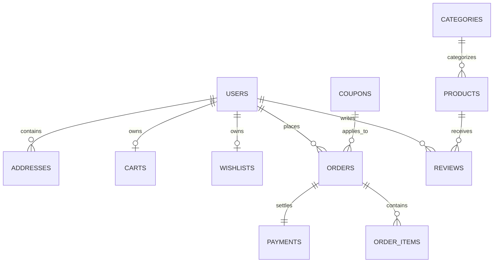

# NOVA STORE — MongoDB Database Schema Specification

This document defines the 10 core MongoDB collections, document structures, data types, indexes, and relationship models for NOVA STORE.

---

## 1. Entity-Relationship Overview



---

## 2. Collections & Document Specifications

### 2.1 `users`
Represents registered customers and administrative staff.

```json
{
  "_id": "ObjectId",
  "email": "customer@novastore.com",
  "password_hash": "$2b$12$...",
  "full_name": "Aether Vance",
  "role": "customer",                // "customer" | "admin"
  "phone": "+1-415-555-0199",
  "is_active": true,
  "addresses": [
    {
      "id": "addr_984f47c2",
      "label": "Headquarters",
      "street": "100 Innovation Boulevard, Suite 400",
      "city": "San Francisco",
      "state": "CA",
      "postal_code": "94107",
      "country": "United States",
      "is_default": true
    }
  ],
  "created_at": "2026-11-06T10:00:00Z",
  "updated_at": "2026-11-06T10:00:00Z"
}
```
**Indexes**:
- `{ "email": 1 }` (Unique)
- `{ "role": 1 }`

---

### 2.2 `categories`
Product classifications for navigation and filtering.

```json
{
  "_id": "ObjectId",
  "name": "Spatial Audio",
  "slug": "spatial-audio",
  "description": "Acoustic masterpieces engineered with titanium diaphragms and real-time head tracking.",
  "image_url": "https://images.unsplash.com/photo-1505740420928-5e560c06d30e",
  "is_featured": true,
  "sort_order": 1,
  "created_at": "2026-11-06T10:00:00Z"
}
```
**Indexes**:
- `{ "slug": 1 }` (Unique)
- `{ "is_featured": 1 }`

---

### 2.3 `products`
The core catalog item document containing variants, pricing, inventory, and editorial specs.

```json
{
  "_id": "ObjectId",
  "title": "NOVA Eclipse X-1 Headphones",
  "slug": "nova-eclipse-x-1",
  "subtitle": "Precision Titanium Spatial Audio with Active Bio-Acoustics",
  "description": "Crafted from aerospace-grade titanium and memory foam, the Eclipse X-1 delivers studio-grade acoustics...",
  "category_id": "ObjectId('672b1234567890abcdef0001')",
  "category_slug": "spatial-audio",
  "price": 499.00,
  "compare_at_price": 599.00,
  "stock": 45,
  "sku": "NOV-ECL-001",
  "images": [
    "https://images.unsplash.com/photo-1505740420928-5e560c06d30e",
    "https://images.unsplash.com/photo-1583394838336-acd977736f90"
  ],
  "featured_image": "https://images.unsplash.com/photo-1505740420928-5e560c06d30e",
  "attributes": {
    "colors": ["Obsidian Black", "Cosmic Silver", "Nebula Purple"],
    "connectivity": "Bluetooth 5.4 / Ultra-wideband",
    "battery_life": "60 Hours",
    "weight": "240g"
  },
  "ratings_average": 4.9,
  "reviews_count": 86,
  "is_featured": true,
  "is_trending": true,
  "tags": ["audio", "flagship", "spatial", "titanium"],
  "created_at": "2026-11-06T10:00:00Z",
  "updated_at": "2026-11-06T10:00:00Z"
}
```
**Indexes**:
- `{ "slug": 1 }` (Unique)
- `{ "category_slug": 1 }`
- `{ "price": 1 }`
- `{ "ratings_average": -1 }`
- Text Index: `{ "title": "text", "description": "text", "tags": "text" }`

---

### 2.4 `carts`
State of in-progress customer shopping carts.

```json
{
  "_id": "ObjectId",
  "user_id": "ObjectId('672b1234567890abcdef0002')", // Nullable for anonymous guest
  "session_id": "guest_session_uuid_token",
  "items": [
    {
      "product_id": "ObjectId('672b1234567890abcdef0003')",
      "variant_color": "Obsidian Black",
      "quantity": 1,
      "price_at_addition": 499.00
    }
  ],
  "applied_coupon": "NOVA10",
  "updated_at": "2026-11-06T10:15:00Z"
}
```
**Indexes**:
- `{ "user_id": 1 }` (Sparse Unique)
- `{ "session_id": 1 }`

---

### 2.5 `wishlists`
Customer curated product wishlists.

```json
{
  "_id": "ObjectId",
  "user_id": "ObjectId('672b1234567890abcdef0002')",
  "product_ids": [
    "ObjectId('672b1234567890abcdef0003')"
  ],
  "updated_at": "2026-11-06T10:15:00Z"
}
```
**Indexes**:
- `{ "user_id": 1 }` (Unique)

---

### 2.6 `orders`
Immutable snapshot of purchased products, customer shipping details, financial calculations, and fulfillment history.

```json
{
  "_id": "ObjectId",
  "order_number": "NOV-20261106-9481",
  "user_id": "ObjectId('672b1234567890abcdef0002')",
  "customer_email": "customer@novastore.com",
  "customer_name": "Aether Vance",
  "shipping_address": {
    "street": "100 Innovation Boulevard, Suite 400",
    "city": "San Francisco",
    "state": "CA",
    "postal_code": "94107",
    "country": "United States"
  },
  "items": [
    {
      "product_id": "ObjectId('672b1234567890abcdef0003')",
      "title": "NOVA Eclipse X-1 Headphones",
      "variant": "Obsidian Black",
      "quantity": 1,
      "unit_price": 499.00,
      "total_price": 499.00,
      "image_url": "https://images.unsplash.com/photo-1505740420928-5e560c06d30e"
    }
  ],
  "subtotal": 499.00,
  "discount_amount": 49.90,
  "shipping_fee": 0.00,
  "tax_amount": 35.93,
  "total_amount": 485.03,
  "currency": "INR",
  "payment_status": "PAID",        // "PENDING" | "PAID" | "FAILED" | "REFUNDED"
  "order_status": "PROCESSING",     // "PENDING" | "PROCESSING" | "SHIPPED" | "DELIVERED" | "CANCELLED"
  "razorpay_order_id": "order_Rz12345678",
  "razorpay_payment_id": "pay_Rz87654321",
  "razorpay_signature": "sha256_verified_signature",
  "timeline": [
    { "status": "ORDER_CREATED", "timestamp": "2026-11-06T10:20:00Z", "note": "Checkout initiated" },
    { "status": "PAYMENT_CONFIRMED", "timestamp": "2026-11-06T10:21:00Z", "note": "Razorpay payment captured" }
  ],
  "created_at": "2026-11-06T10:20:00Z",
  "updated_at": "2026-11-06T10:21:00Z"
}
```
**Indexes**:
- `{ "order_number": 1 }` (Unique)
- `{ "user_id": 1 }`
- `{ "order_status": 1 }`
- `{ "razorpay_order_id": 1 }`

---

### 2.7 `payments`
Cryptographic payment verification records.

```json
{
  "_id": "ObjectId",
  "order_id": "ObjectId('672b1234567890abcdef0004')",
  "razorpay_order_id": "order_Rz12345678",
  "razorpay_payment_id": "pay_Rz87654321",
  "amount": 48503,                 // Minor currency units (paise)
  "currency": "INR",
  "status": "captured",
  "method": "upi",
  "verified_at": "2026-11-06T10:21:00Z"
}
```
**Indexes**:
- `{ "razorpay_order_id": 1 }`
- `{ "razorpay_payment_id": 1 }` (Unique)

---

### 2.8 `coupons`
Discount promotional campaigns.

```json
{
  "_id": "ObjectId",
  "code": "NOVALUXURY",
  "discount_type": "PERCENTAGE",   // "PERCENTAGE" | "FIXED"
  "discount_value": 15,            // 15% or $15
  "min_order_amount": 200.00,
  "max_discount_cap": 100.00,
  "usage_limit": 500,
  "usage_count": 42,
  "is_active": true,
  "valid_until": "2027-01-01T00:00:00Z"
}
```
**Indexes**:
- `{ "code": 1 }` (Unique)

---

### 2.9 `reviews`
Verified buyer customer feedback and ratings.

```json
{
  "_id": "ObjectId",
  "product_id": "ObjectId('672b1234567890abcdef0003')",
  "user_id": "ObjectId('672b1234567890abcdef0002')",
  "user_name": "Aether Vance",
  "rating": 5,
  "title": "Acoustic transcendence",
  "comment": "The tactile response and titanium chassis set a new benchmark.",
  "is_verified_buyer": true,
  "created_at": "2026-11-06T10:30:00Z"
}
```
**Indexes**:
- `{ "product_id": 1, "created_at": -1 }`
- `{ "user_id": 1 }`

---

### 2.10 `newsletters`
Email subscription list for promotional campaigns and product drops.

```json
{
  "_id": "ObjectId",
  "email": "subscriber@domain.com",
  "is_active": true,
  "source": "homepage_footer",
  "subscribed_at": "2026-11-06T10:35:00Z"
}
```
**Indexes**:
- `{ "email": 1 }` (Unique)

---

### 2.11 `addresses`
Stand-alone / reusable customer shipping and billing addresses.

```json
{
  "_id": "ObjectId",
  "user_id": "ObjectId('672b1234567890abcdef0002')",
  "full_name": "Aether Vance",
  "phone": "+1-415-555-0199",
  "street": "100 Innovation Boulevard, Suite 400",
  "city": "San Francisco",
  "state": "CA",
  "postal_code": "94107",
  "country": "United States",
  "is_default": true,
  "created_at": "2026-11-06T10:00:00Z",
  "updated_at": "2026-11-06T10:00:00Z"
}
```
**Indexes**:
- `{ "user_id": 1 }`


